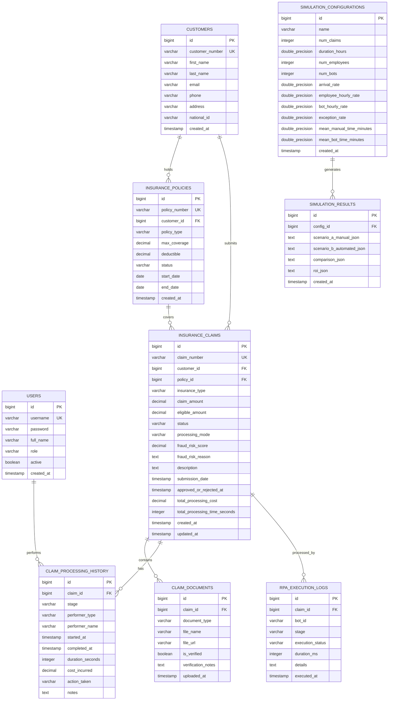

# Database Design and Schema Specification

## 1. Entity-Relationship Diagram

## 2. Table Specifications & Indexes

1. **`users`**:
   - `id` (BIGSERIAL, PRIMARY KEY)
   - `username` (VARCHAR(50), NOT NULL, UNIQUE)
   - `password` (VARCHAR(255), NOT NULL) - BCrypt encrypted
   - `full_name` (VARCHAR(100), NOT NULL)
   - `role` (VARCHAR(30), NOT NULL) - `ROLE_ADMIN`, `ROLE_CLAIM_PROCESSOR`
   - `active` (BOOLEAN, DEFAULT TRUE)

2. **`insurance_claims`**:
   - Status values: `PENDING`, `UNDER_REVIEW`, `APPROVED`, `REJECTED`, `FLAGGED_FOR_MANUAL`
   - Processing mode: `MANUAL`, `AUTOMATED`
   - Insurance types: `HEALTH`, `VEHICLE`, `LIFE`
   - Indexes on: `claim_number` (UNIQUE), `status`, `insurance_type`, `submission_date`

3. **`claim_processing_history`**:
   - Performer type: `HUMAN`, `RPA_BOT`
   - Stage values: `DOCUMENT_VERIFICATION`, `POLICY_VALIDATION`, `AMOUNT_VERIFICATION`, `FRAUD_DETECTION`, `DECISION`
   - Tracks duration in seconds and labor / execution cost incurred.
